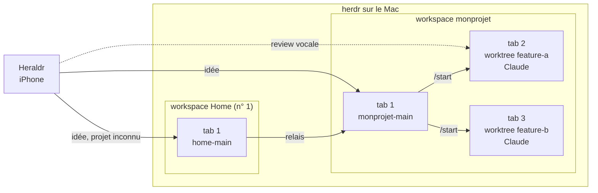
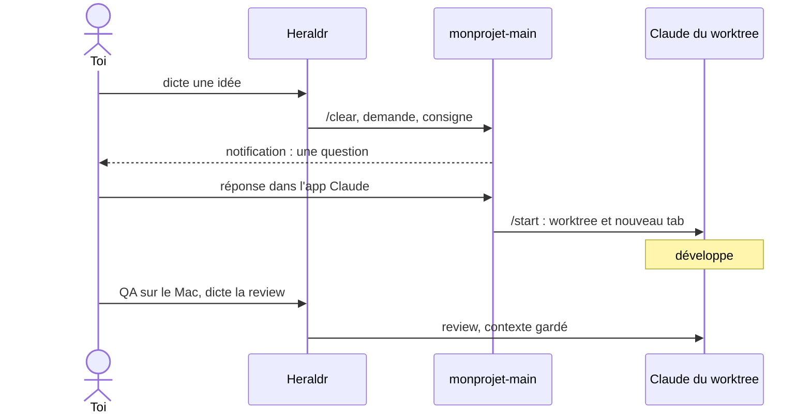

# Heraldr

Compagnon de développement voice first pour herdr et Claude Code. Depuis
l'iPhone, tu dictes une idée et le développement démarre sur le Mac ;
pendant la QA, tu dictes ta review au Claude qui a écrit la feature.

Ce n'est pas un client herdr généraliste. L'app ne marche que si herdr
et Claude sont organisés d'une façon précise, la mienne : c'est un
setup personnel, installé directement sur mon iPhone, sans
TestFlight ni App Store. Pour piloter herdr finement depuis un
téléphone, avec terminal, diffs et uploads, il y a
[Heeler](https://github.com/ZingerLittleBee/Heeler) ; les deux
cohabitent sur le même Mac.

## Les conventions imposées

- Un workspace herdr par projet. Son tab 1 héberge un Claude nommé
  `<slug>-main` (`monprojet-main`), créé par l'app s'il manque. Il ne
  code pas : il reçoit chaque demande sur un contexte vierge (`/clear`),
  explore le code, pose ses questions, puis dispatche le travail avec
  `/start`.
- `/start` crée un worktree et ouvre un nouveau tab avec son propre
  Claude : chaque tab au-delà du premier est une feature en cours.
- Le workspace numéro 1 de herdr, Home, sert de dispatch global et de
  cible par défaut. Quand tu ne sais pas encore dans quel projet tombe
  une idée, tu lui parles : il identifie le projet parmi les workspaces
  ouverts, demande en cas de doute, et relaie au `<slug>-main` concerné.
- Les Claude tournent en yolo mode (`--dangerously-skip-permissions`),
  en Remote Control pour être joignables depuis l'app Claude.
- Rien ne tourne en permanence sur le Mac : l'app passe par SSH, à
  travers l'API de herdr et un script de file (`dispatch.sh`) qu'elle
  réinstalle à chaque envoi. Un envoi vers un Claude occupé attend sur
  le Mac qu'il ait fini, dans l'ordre.

`/start` est un skill Claude Code personnel, hors de ce dépôt.

## Deux usages

### Lancer une idée

Gros bouton voix, tu parles, la dictée est
transcrite et nettoyée sur l'iPhone, tu relis, tu envoies. Le
`<slug>-main` du workspace choisi (ou Home) reçoit la demande avec une
consigne : explorer sans rien modifier, poser ses questions, finir par
`/start`. Quand il pose une question, une notification arrive ; la
toucher ouvre sa session dans l'app Claude pour répondre.

### Itérer sur une feature en cours

Pendant que tu testes sur le Mac,
appui long sur la tuile du workspace, « Cibler un tab de `<label>` »,
et tu choisis le tab du worktree. Ce que tu dictes part au Claude de ce
tab avec un simple avertissement de dictée, sans consigne et, par
défaut, sans `/clear` : il garde le contexte de la feature et prend ta
review comme un message de plus.

## Documentation

- [Vision : pourquoi ce setup](docs/vision.md)
- [Spécification](docs/spec.md) : comportement normatif, contrat avec
  le Mac
- [Architecture](docs/architecture.md)
- [Toolchain](docs/toolchain.md)
- [Design](docs/design.md)
- [Roadmap](docs/roadmap.md)
- [Journal des décisions](docs/decisions.md)
- [Risques et points à vérifier](docs/risks.md)
- [QA manuelle sur l'iPhone](QA.md)
- Livrables de création : [nom et logo](docs/branding/), [protos
  UI](docs/protos/)
