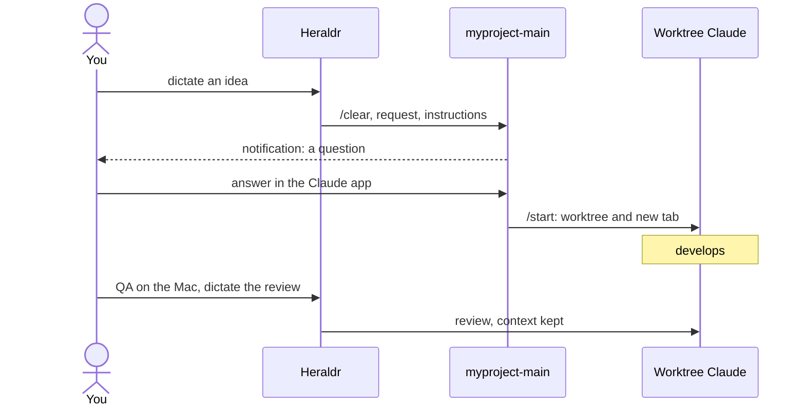

# Heraldr

Heraldr is an iOS app that dispatches work to Claude Code agents running
in herdr workspaces on a Mac. From the iPhone, you dictate an idea and
development starts on the Mac; during QA, you dictate your review to
the Claude that wrote the feature. The app talks to the Mac over SSH,
with nothing running permanently on the Mac side.

**Work in progress.** The project changes quickly, with no stability
guarantees: commands, conventions and the contract with the Mac can
break from one commit to the next.

This is not a general-purpose herdr client. The app only works if herdr
and Claude are organized in one specific way, mine: it was built for my
own use and is installed directly on my iPhone, without TestFlight or
the App Store. To drive herdr in depth from a phone, with a terminal,
diffs and uploads, use [Heeler](https://github.com/ZingerLittleBee/Heeler);
both can live on the same Mac.

## Required conventions


- One herdr workspace per project. Its tab 1 hosts a Claude named
  `<slug>-main` (`myproject-main`), created by the app if missing. It
  does not write code: it receives each request on a fresh context
  (`/clear`), explores the code, asks its questions, then dispatches
  the work with `/start`.
- `/start` creates a worktree and opens a new tab with its own Claude:
  every tab past the first one is a feature in progress.
- herdr's workspace number 1, Home, is the global dispatcher and the
  default target. When you don't know yet which project an idea belongs
  to, you talk to it: it finds the project among the open workspaces,
  asks when in doubt, and relays to the right `<slug>-main`.
- The Claudes run in yolo mode (`--dangerously-skip-permissions`), with
  Remote Control on so they can be reached from the Claude app.
- Nothing runs permanently on the Mac: the app goes through SSH, using
  herdr's API and a queue script (`dispatch.sh`) that it reinstalls on
  every send. A request sent to a busy Claude waits on the Mac until it
  is done, in order.

`/start` is a personal Claude Code skill, not part of this repository.

## Two uses



### Start an idea

Big voice button, you speak, the dictation is transcribed and cleaned
up on the iPhone, you proofread, you send. The `<slug>-main` of the
chosen workspace (or Home) receives the request with instructions:
explore without changing anything, ask questions, finish with `/start`.
When it asks a question, a notification arrives; tapping it opens its
session in the Claude app so you can answer.

### Iterate on a feature in progress

While you test on the Mac, long-press the workspace tile, pick
"Target a tab of `<label>`", and choose the worktree's tab. What you
dictate goes to that tab's Claude with a short dictation notice, no
instructions and, by default, no `/clear`: it keeps the feature's
context and takes your review as one more message.

## Requirements

- An iPhone on iOS 26 (dictation cleanup uses Apple Intelligence)
- A Mac running herdr and Claude Code, with Remote Login (SSH) enabled
- Xcode 26 and an Apple developer team to sign the app

## Setup

```sh
bin/setup-ios        # checks Xcode, installs XcodeGen and pinned lint tools, Heeler submodule
bin/generate-ios     # generates the Xcode project from ios/project.yml
bin/run-ios          # build and run on the simulator
```

Signing settings stay out of the repository. Create
`ios/Signing.local.xcconfig` (ignored by git):

```
DEVELOPMENT_TEAM = <team id>
HERALDR_BUNDLE_ID = <bundle id>
```

Push notifications need an explicit App ID, so the bundle id must be
one your team owns. To install on the iPhone, create `.env.local`
(ignored) with the device's CoreDevice UUID
(`xcrun devicectl list devices`):

```sh
IOS_DEVICE_UUID=<uuid>
# Optional, when Xcode has no Apple account: App Store Connect API key
# used to create the App ID and provisioning profile
ASC_KEY_ID=<key id>
ASC_KEY_ISSUER_ID=<issuer id>
ASC_KEY_PATH=~/.private_keys/AuthKey_<key id>.p8
```

Then `bin/run-ios-device`. See [docs/toolchain.md](docs/toolchain.md)
for every script, and `bin/run-ios-tests`, `bin/lint` and
`bin/local-ci` for checks.

## Documentation

- [Vision: why this setup](docs/vision.md)
- [Specification](docs/spec.md): normative behavior, contract with the
  Mac
- [Architecture](docs/architecture.md)
- [Toolchain](docs/toolchain.md)
- [Design](docs/design.md)
- [Roadmap](docs/roadmap.md)
- [Decision log](docs/decisions.md)
- [Risks and things to check](docs/risks.md)
- [Manual QA on the iPhone](QA.md)
- Creative work: [name and logo](docs/branding/)

## License

MIT, see [LICENSE](LICENSE). Heraldr vendors
[Heeler](https://github.com/ZingerLittleBee/Heeler) (Apache 2.0) as a
submodule in `Vendor/Heeler`, see [NOTICE](NOTICE).
